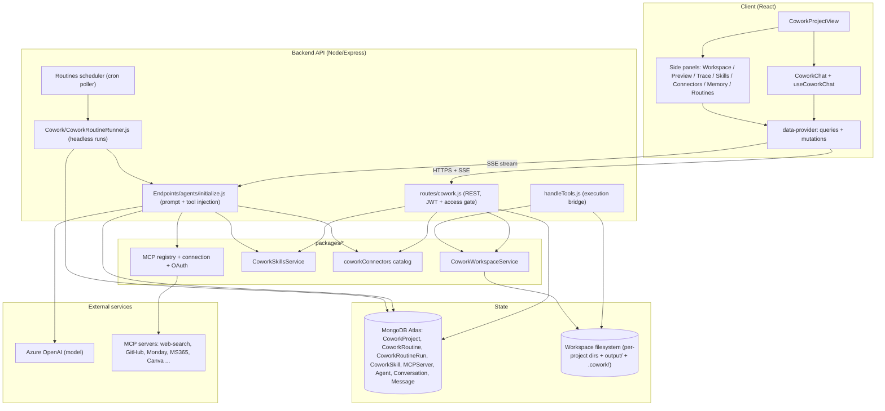
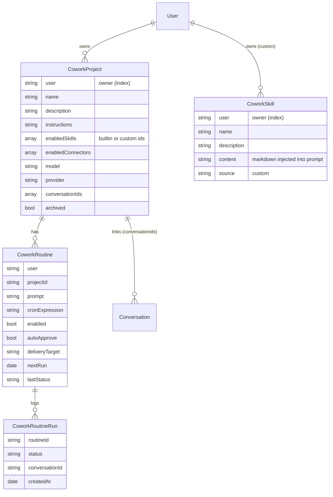
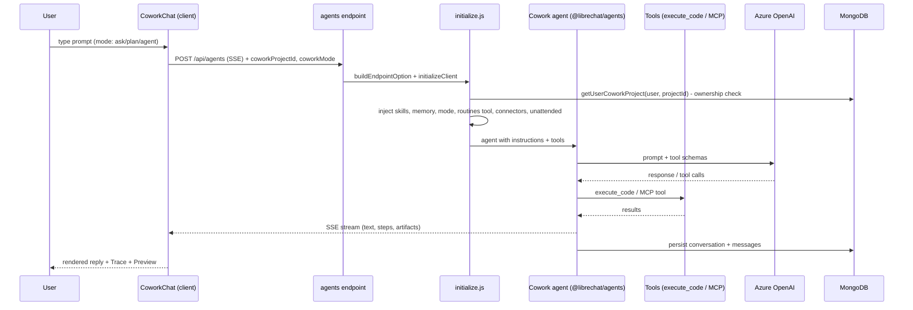
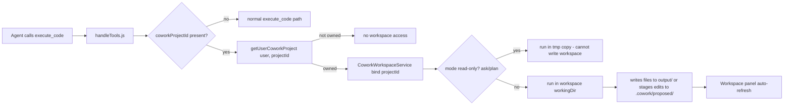
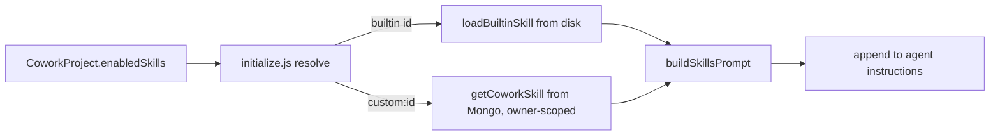
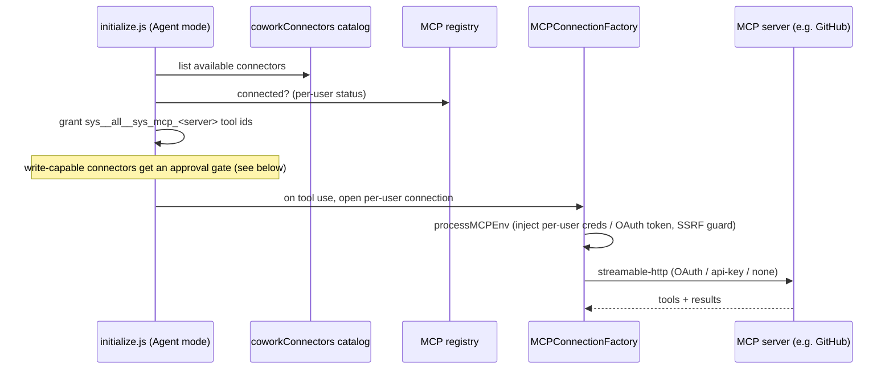
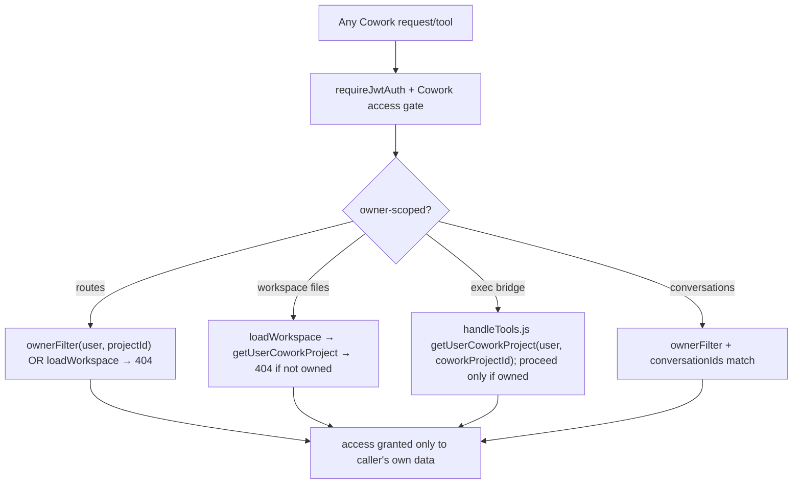
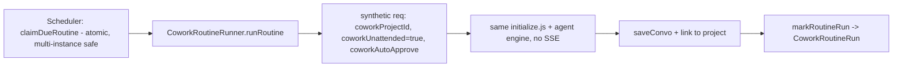
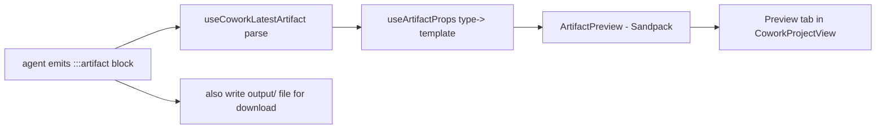
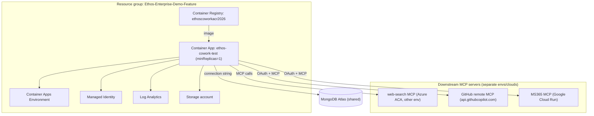

# Cowork — Architecture Overview

_Audience: engineering review. This document explains how the Cowork module is built on top of the
LibreChat fork, how a request flows end‑to‑end, the data model, the subsystems (skills, connectors,
routines, execution, live preview), the multi‑tenant isolation model, and the deployment topology.
Diagrams are Mermaid (render on GitHub / most IDEs)._

---

## 1. What Cowork is

Cowork is an **autonomous workspace agent** layered onto the existing LibreChat‑based product. A user
creates a **Cowork project**, chats with the **Cowork agent** (a single seeded agent,
`agent_cowork_default`), and the agent inspects a per‑project **workspace**, runs code, produces files,
and can use **skills** and external **connectors** (MCP servers). Work can also be **scheduled** to run
headless (routines).

### Design principles (non‑negotiable)

- **Additive & isolated.** All Cowork behavior is gated on `req.body.coworkProjectId`. It never changes
  the main chat, other agents, or the global tool registry.
- **Per‑user / multi‑tenant.** Every project, workspace, skill, routine, and credential is owner‑scoped
  by `user`. No cross‑tenant access (see §9).
- **Reuse, don't fork.** Cowork runs on the existing `@librechat/agents` engine and the existing MCP
  stack; Cowork adds its own collections and a thin injection layer, not a parallel engine.

---

## 2. High‑level architecture



---

## 3. Data model (Cowork‑owned collections)

Cowork adds its own MongoDB collections, separate from the shared LibreChat ones (Agent, Conversation,
Message). `MCPServer` is a shared LibreChat collection reused for custom connectors (Phase D).



Owner scoping is enforced by a shared filter `ownerFilter(user, id) = { _id: id, user }` used in every
Cowork model function (see §9).

---

## 4. Core runtime — the agent run

Every Cowork message runs through the standard agents endpoint, but `initialize.js` injects
Cowork‑specific context **only when `coworkProjectId` is present**.



**Injection order in `initialize.js` (all gated on `coworkProjectId`):**
1. **Skills** — load enabled skills (builtin + custom) → `buildSkillsPrompt` → append to instructions.
2. **Project memory** — inject budget‑capped core memory (outranks global memory).
3. **Mode** — Ask/Plan get read‑only behavior; Agent is full (see §7).
4. **Routines tool** — Agent mode only: grant `manage_routines`.
5. **Connectors** — Agent mode only: grant connected connectors' MCP tools + write‑safety gate.
6. **Unattended** — routine runs only: suppress clarifying questions, always produce a deliverable.

---

## 5. Execution bridge (running code in the workspace)

The agent's `execute_code` tool runs in the **project's own workspace directory** — resolved from
`coworkProjectId` with an ownership re‑check — not a generic sandbox.



Workspace layout per project: files at root + `output/` (deliverables), `.cowork/memory/`
(`core.md`, `archive.md`), `.cowork/proposed/` (staged edits for review/apply), and checkpoints for undo.

---

## 6. Skills

Skills inject authoritative instructions into the agent prompt when enabled per project.

- **Built‑in** skills live on disk: `api/lib/skills/{docx,pdf,pptx,xlsx,skill-creator}/SKILL.md`
  (YAML frontmatter + markdown body), read by `CoworkSkillsService`.
- **Custom** skills (Phase A2) are per‑user records in `CoworkSkill`, created/deleted via
  `POST/DELETE /api/cowork/skills`, markdown‑only.
- A project's `enabledSkills[]` holds builtin ids and `custom:<id>` references. At run time
  `initialize.js` resolves both sources and calls `buildSkillsPrompt(...)`.



---

## 7. Modes

`coworkMode` (sent only by the Cowork chat) steers behavior per message:

- **Ask** — answer conversationally; workspace is **read‑only, enforced at the execution layer**
  (`execute_code` runs in a tmp copy), not just by prompt.
- **Plan** — return only a structured implementation plan; read‑only.
- **Agent** — full autonomy: execute code, write files, use routines + connectors.

---

## 8. Connectors and MCP

Connectors are external tools backed by **MCP servers**. Two layers:

- **Catalog connectors** (`packages/api/src/cowork/coworkConnectors.ts`): a curated list (YouTube,
  WordPress, Mailchimp, Airtable, Monday, MS365, Canva, **GitHub**). Auth is `oauth`, `apikey`, or
  `platform`. API‑key creds ride a **credential bridge** (per‑user vars `mcp_<server>` →
  `processMCPEnv`), OAuth uses the MCP OAuth flow.
- **Custom connectors** (Phase D, planned): per‑user remote MCP servers the teacher adds themselves,
  reusing the existing `MCPServer` collection + registry (see §11).



**Write safety.** Today's gate is **soft (prompt‑only)**: write‑capable connectors get an instruction
to preview the action and wait for approval. Unattended routine runs **withhold** write‑capable
connectors entirely unless the routine opts into `autoApprove`. Hardening this to an **enforced
interceptor** is Phase B1.

---

## 9. Multi‑tenant isolation (audited — Phase B2)

Every route and the agent‑side execution bridge re‑check ownership; there are no IDOR gaps.



Regression tests (`api/models/__tests__/coworkIsolation.spec.js`) assert every ownership function stays
owner‑scoped, so a future edit that drops `user` from a query fails CI.

---

## 10. Routines (scheduled automations)

A routine is a saved prompt + schedule bound to a project. Runs are **headless** — no browser, no human.



Because there's no human at run time: **clarifying questions are suppressed** (unattended instruction),
and **write‑capable connectors are withheld** unless `autoApprove`. Delivery target: message or a file
written into the workspace.

---

## 11. Live preview / artifacts (Phase A1)

The Cowork agent has `artifacts: 'default'`, so it emits `:::artifact{...}:::` blocks. A client hook
parses the latest artifact and renders it live via the existing Sandpack stack in a **Preview** tab; the
agent also writes the file to `output/` for download.



---

## 12. Custom connectors — planned (Phase D)

The key finding from the design spike: **runtime, per‑user MCP registration already exists** in the fork
(`MCPServer` collection + `/api/mcp/servers` CRUD + the registry that merges DB servers per user, with
OAuth, API‑key, encryption, and SSRF all built). So "add your own connector" is the **same mechanism
admins use for normal‑chat MCP servers**, plus a thin Cowork layer:

1. Store the server as an `MCPServer` record marked Cowork‑only (`chatMenu:false`), per‑user.
2. Inject the user's custom servers into the Cowork agent's connector loop.
3. Add an "Add connector" UI (auth types: none / api‑key / OAuth‑app) in the Cowork Connectors panel.

Decisions locked: any user may add; **HTTPS remote‑only + SSRF guard**; auth includes OAuth apps.

---

## 13. Deployment topology (Azure)



- Config is **infrastructure‑as‑code**: `deploy/azure/main.bicep` + `main.parameters.json` (`plainEnv` /
  `secretEnv`). `deploy/azure/librechat.azure.yaml` is the prod LibreChat config (env‑substituted).
- **Cold‑start note:** the app is kept warm (`minReplicas=1`); first‑response latency after idle comes
  from the **downstream MCP servers** cold‑starting (esp. web‑search, loaded on every run). Fix:
  `min-replicas=1` on those services, or pre‑warm.

---

## 14. Status & roadmap

| Phase | Item | Status |
|---|---|---|
| A1 | Live artifact preview | ✅ Done |
| A2 | Custom skills (per‑user) | ✅ Done |
| A3 | GitHub read connector (OAuth) | ✅ Done |
| B2 | Multi‑tenant isolation audit + tests | ✅ Done |
| B1 | Enforced write‑action interceptor | ⬜ Planned (before writes ship) |
| C1 | GitHub workspace git (clone/commit/push) | ⬜ Planned |
| C2 | Finish connector catalog + connector writes | ⬜ Planned |
| D | Bring‑your‑own MCP (custom connectors) | ⬜ Planned (spiked) |

Ordering rationale: **B before C/D** — the enforced write gate (B1) and isolation audit (B2) are the
foundation everything with external writes depends on.

---

## 15. Key files (index)

- Routes: `api/server/routes/cowork.js`
- Runtime injection: `api/server/services/Endpoints/agents/initialize.js`
- Execution bridge: `api/app/clients/tools/util/handleTools.js`
- Headless runner: `api/server/services/Cowork/CoworkRoutineRunner.js`
- Agent seed: `config/seed-cowork-agent.js` (id `agent_cowork_default`)
- Models: `api/models/CoworkProject.js`, `CoworkRoutine.js`, `CoworkRoutineRun.js`, `CoworkSkill.js`
- Schemas: `packages/data-schemas/src/schema/cowork*.ts`
- Services: `packages/api/src/cowork/` (`CoworkWorkspaceService`, `CoworkSkillsService`, `coworkConnectors`)
- MCP stack: `packages/api/src/mcp/` (registry, connection, OAuth)
- Client: `client/src/components/Cowork/*`, data layer `client/src/data-provider/Cowork/*`
- Isolation tests: `api/models/__tests__/coworkIsolation.spec.js`
- Deploy: `deploy/azure/main.bicep`, `main.parameters.json`, `librechat.azure.yaml`
```
